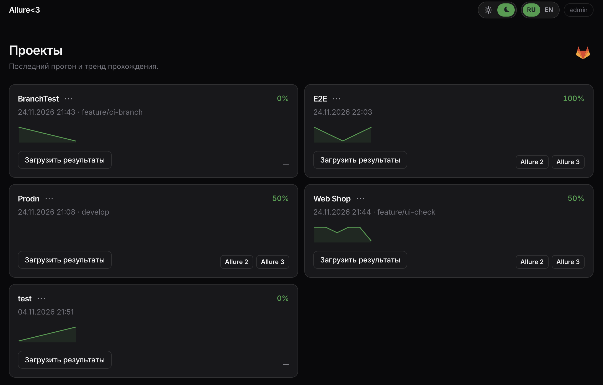
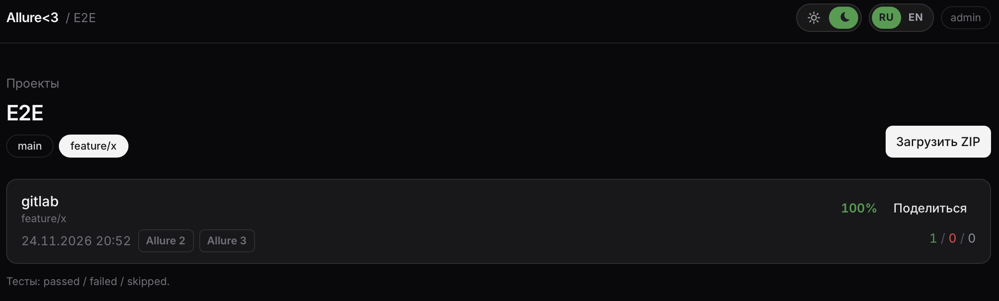

# Allure ❤️

Хранилище Allure-отчётов с полноценным бэкендом на FastAPI. Каждый прогон собирается
официальным CLI — **Allure 2** (через Java) и **Allure 3** (через Node) — поэтому
графики, шаги и вложения такие же, как у обычного `allure generate`. Сверху —
вход через Keycloak, CI-токены, история тренда, стабильные ссылки и badge.

Фронтенд — лёгкий одностраничный интерфейс (`web/index.html`), который работает
с живыми данными бэкенда по API. Никаких заглушек: загрузка, выпуск токенов,
гостевые ссылки, переименование и удаление — всё настоящие запросы к бэкенду.

## Содержание

- [Возможности](#возможности)
- [Скриншоты](#скриншоты)
- [Быстрый старт](#быстрый-старт)
  - [Docker Compose](#docker-compose)
  - [Запуск без Docker](#запуск-без-docker-для-разработки)
- [Демо-данные](#демо-данные)
- [Загрузка результатов из CI](#загрузка-результатов-из-ci)
- [Конфигурация](#конфигурация)
- [Тесты](#тесты)
- [Docker-образ](#docker-образ)
- [Структура проекта](#структура-проекта)

## Возможности

- **Проекты** — создание, переименование, удаление; у каждого проекта свои прогоны и CI-токены.
- **Сборка отчётов** — каждый прогон собирается дважды:
  - **Allure 2** — `/reports/{проект}/{прогон}/index.html`
  - **Allure 3** — `/reports/{проект}/{прогон}/v3/index.html`
  - Если третья версия не собралась, прогон остаётся доступным — просто без ссылки на v3.
  - Из прошлого отчёта копируется `history`, чтобы в отчёте был тренд по тем же тестам.
- **Загрузка результатов** — zip или отдельные `*-result.json`, с прогрессом и обработкой ошибок.
- **Токены для CI** — один токен на проект, отправка в заголовке `X-API-Token` (или `Authorization: Bearer`).
- **Гостевые ссылки** — `/s/{token}` открывает отчёт без входа; срок 24 часа или 7 дней, при необходимости отзывается.
- **Badge** — `/projects/{проект}/badge.svg`, отдаётся без входа.
- **API** — `GET /api/projects` (список для интерфейса) и `GET /api/projects/{проект}` (детали).
- **Ветки** — прогоны группируются по `execution_branch`, в проекте можно фильтровать по ветке.

## Скриншоты

| Список проектов | Прогоны по веткам |
|---|---|
|  |  |

> Скриншоты лежат в `docs/img/`. Чтобы обновить — замените PNG с теми же именами.

## Быстрый старт

Понадобится одно из двух:

- **Docker** + Docker Compose — для запуска «как в бою».
- **Python 3.11+**, **Java 17** и **Node.js 18+** — для локальной разработки без Docker
  (Java/Node нужны только для генераторов отчётов).

### Docker Compose

Сначала подготовьте `.env` (секреты/конфигурация берутся отсюда):

```bash
cp .env.example .env
# при необходимости отредактируйте .env (секреты, BASE_URL, хосты)
```

Затем:

```bash
docker compose up -d --build
```

или через Makefile: `make up`.

Поднимутся два контейнера:

| Сервис     | Адрес                 | Назначение                                                            |
|------------|-----------------------|-----------------------------------------------------------------------|
| `allure-hub` | http://localhost:8090 | Интерфейс + бэкенд Allure                                             |
| `keycloak` | http://localhost:8088 (app) · https://localhost:8443 (консоль) | Identity Provider (realm `allure`, клиент `allure`) |

Вход — через Keycloak. По умолчанию: логин `admin`, пароль `admin` (админ Keycloak
контейнера, задан через `KC_BOOTSTRAP_ADMIN_USERNAME` / `KC_BOOTSTRAP_ADMIN_PASSWORD`).

> **Keycloak запускается в режиме `start-dev`** — это dev-режим (без TLS на 8080,
> с авто-импортом realm). Он не предназначен для продакшена: на боевом стенде
> настройте Keycloak на production-конфигурацию (собственный `KC_HOSTNAME`, TLS,
> `--start` вместо `--start-dev`) и замените секреты в `.env`.
>
> **Админ-консоль** открывается по **`https://localhost:8443`** (клиент
> `security-admin-console` в `master` требует HTTPS). Сертификат самоподписанный
> (`deploy/keycloak/tls/`) — браузер предупредит, это ожидаемо. Внутренний
> токен-обмен `allure-hub` → Keycloak идёт по http (`keycloak:8080`).

### Запуск без Docker (для разработки)

Нужны установленные CLI: `allure` (2, требует Java) и `allure3` (3, npm-пакет `allure@3`).

```bash
python3 -m venv .venv
.venv/bin/pip install -r backend/requirements.txt

cd backend
ALLURE_BIN=allure ALLURE3_BIN=allure3 PORT=8090 ../.venv/bin/python -m server
```

или через Makefile: `make dev`.

Сервис будет слушать `http://localhost:8090`. Вход — через Keycloak (`GET /login`);
для разработки/тестов доступен и локальный логин (`POST /login`).

По умолчанию без `DATA_DIR` данные пишутся в `backend/data/` (SQLite + прогоны).
В Docker используется том `/data`.

## Демо-данные

```bash
make seed
```

Наполняет стенд **обезличенными** демо-данными за один вызов (поднимать стенд не нужно,
он уже должен работать — `docker compose up -d`):

- 4 проекта: `web-shop`, `mobile-app`, `billing`, `search-service`;
- у `web-shop` — ветки `main`, `release/1.2`, `feature/payment`, у `mobile-app` —
  `develop` и `main`.

Данные генерируются фейковыми (`scripts/seed.py`): настоящие `*-result.json`
упаковываются в zip и загружаются через реальный API (`POST
/projects/{slug}/results`, поле `execution_branch`) — отчёты Allure 2/3 собирает сам
бэкенд. Команда идемпотентна: повторный запуск не плодит дубликаты.

## Загрузка результатов из CI

Проекту нужен CI-токен. Его выпускает администратор в интерфейсе
или через API: `POST /api/projects/{проект}/token`.

Перед загрузкой упакуйте результаты — например, из директории `allure-results`:

```bash
zip -r results.zip allure-results
```

Принимаются поля файла `files`, `file` и `allureResults`. Дополнительно
поддерживаются `execution_name`, `execution_url`, `execution_type`,
`execution_branch` и `environment`.

### GitLab

```bash
curl -F files=@results.zip \
  -F execution_name=gitlab \
  -F execution_url="$CI_PIPELINE_URL" \
  -F execution_type=gitlab \
  -F execution_branch="$CI_COMMIT_BRANCH" \
  -H "X-API-Token: $ALLURE_TOKEN" \
  http://localhost:8090/projects/library/results
```

### GitHub Actions

```yaml
- name: Upload to Allure
  run: |
    curl -F files=@results.zip \
      -F execution_name=github \
      -F execution_url="${{ github.server_url }}/${{ github.repository }}/actions/runs/${{ github.run_id }}" \
      -F execution_type=github \
      -F execution_branch="${GITHUB_REF_NAME}" \
      -H "X-API-Token: ${{ secrets.ALLURE_TOKEN }}" \
      http://localhost:8090/projects/library/results
```

### Jenkins

```groovy
stage('Upload to Allure') {
  sh """
    curl -F files=@results.zip \
      -F execution_name=jenkins \
      -F execution_url=${env.BUILD_URL} \
      -F execution_type=jenkins \
      -F execution_branch=${env.BRANCH_NAME} \
      -H "X-API-Token: ${env.ALLURE_TOKEN}" \
      http://localhost:8090/projects/library/results
  """
}
```

## Конфигурация

Конфигурация и секреты задаются через `.env` (шаблон — `.env.example`), который
подхватывается `docker compose` через `env_file: .env`. Основные переменные:

| Переменная            | По умолчанию          | Назначение                              |
|-----------------------|-----------------------|-----------------------------------------|
| `PORT`                | `8090`                | Порт HTTP-сервера                       |
| `DATA_DIR`            | `/data` (Docker) / `backend/data` (локально) | Каталог данных (том) |
| `ADMIN_USERNAME`      | `admin`               | Логин администратора                    |
| `ADMIN_PASSWORD`      | `admin`               | Пароль администратора                   |
| `SECRET_KEY`          | `dev-only-secret`     | Секрет сессий                           |
| `SESSION_SECRET`      | `dev-only-secret`     | Секрет подписи сессий                   |
| `KEEP_REPORTS`        | `20`                  | Сколько последних отчётов хранить       |
| `MAX_UPLOAD_MB`       | `100`                 | Лимит загрузки, МБ                      |
| `MAX_UNPACKED_MB`     | `500`                 | Лимит распаковки архива, МБ             |
| `KEYCLOAK_ISSUER`     | `https://127.0.0.1:8443/realms/allure` | Issuer для браузера (https)    |
| `KEYCLOAK_INTERNAL_ISSUER` | `http://keycloak:8080/realms/allure` | Issuer внутри docker-сети (http, токен-обмен) |
| `KEYCLOAK_CLIENT`     | `allure`              | Client-ID в Keycloak                    |
| `KEYCLOAK_SECRET`     | `change-me-keycloak-secret` | Client-secret в Keycloak          |
| `BASE_URL`            | `http://127.0.0.1:8090` | Внешний адрес (для ссылок в curl)     |
| `ALLURE_BIN`          | `/usr/local/bin/allure` | CLI Allure 2                           |
| `ALLURE3_BIN`         | `/usr/local/bin/allure3` | CLI Allure 3                           |

> **Смена `BASE_URL` (чек-лист).** Если вы меняете внешний адрес стенда, обновите
> в `.env` согласованно:
> - `BASE_URL` — внешний адрес интерфейса/бэкенда;
> - `KEYCLOAK_ISSUER` — issuer Keycloak для браузера (должен смотреть на
>   публичный адрес Keycloak);
> - `KC_HOSTNAME` — внешний адрес самого Keycloak;
> - `redirectUris` клиента `allure` в `deploy/keycloak/allure-realm.json` — на
>   новые URL (например `https://ваш-хост/*`).
>
> После правки realm пересоздайте контейнеры Keycloak, чтобы импорт подхватился.

> **Для боевого стенда** задайте собственные `SECRET_KEY`, `SESSION_SECRET` и
> `KEYCLOAK_SECRET`, а также приведите `redirectUris` в
> `deploy/keycloak/allure-realm.json` к актуальному `BASE_URL`.
> Секреты по умолчанию (`dev-only-secret`, `admin`/`admin`) предназначены только
> для локальной разработки.

### Keycloak: импорт realm

Realm импортируется автоматически при старте (`--import-realm`,
`deploy/keycloak/allure-realm.json`). Для реального стенда поменяйте в этом файле:

- `redirectUris` — приведите к вашему `BASE_URL` (например
  `http://localhost:8090/*`),
- `credentials` клиента `allure` — замените дефолтный `client-secret`.

## Тесты

```bash
python3 -m venv .venv-test
.venv-test/bin/pip install -r requirements-dev.txt

cd backend
../.venv-test/bin/python -m pytest tests/
```

или через Makefile: `make test`.

Покрыты основные сценарии: вход через Keycloak и локальный логин, выпуск и отзыв
токенов, контракт `/api/projects`, загрузка результатов, сборка Allure 2/3,
гостевые ссылки, badge, управление пользователями и проектами.

Тесты не требуют установки Java/Node: генераторы отчётов подменяются фикстурами,
поэтому прогон стабилен на любой машине.

## Docker-образ

`Dockerfile` — рабочий образ сервиса. В нём собран полный рантайм для обоих
генераторов отчётов, которого нет в лёгком `python:3.12-slim`:

- OpenJDK 17 + Allure 2 (`2.46.1`)
- Node.js + Allure 3 (`allure@3.22.1`, переименован в `allure3`)

Запуск — `python -m server` из `/app/backend` на порту `8090`. Положение CLI
задаётся через `ALLURE_BIN` / `ALLURE3_BIN`.

## Структура проекта

```
backend/                  # Бэкенд (FastAPI)
  server/                 #   main.py, auth.py, db.py, ingest.py, settings.py, i18n.py
  templates/              #   Jinja2-шаблоны (login, projects, project, base, error)
  static/                 #   Статика бэкенда (app.css)
  tests/                  #   Тесты (pytest, фикстуры без Java/Node)
  data/                   #   Данные при локальном запуске (SQLite + прогоны; в .gitignore)
  requirements.txt
web/                      # SPA-фронтенд
  index.html              #   Список проектов, загрузка, токены, share, логика рендера
docs/
  img/                    #   Скриншоты для README
deploy/keycloak/          # Realm для Keycloak (allure-realm.json) + tls/ (self-signed)
Dockerfile                # Образ 8090: Java + Allure 2 + Node + Allure 3
docker-compose.yml        # Сервисы: allure-hub (8090), keycloak (8088 http / 8443 https)
Makefile                  # Быстрый запуск: up / down / dev / test / seed
requirements-dev.txt
scripts/
  seed.py                 # Демо-данные (`make seed`)
```